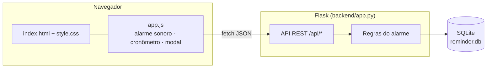
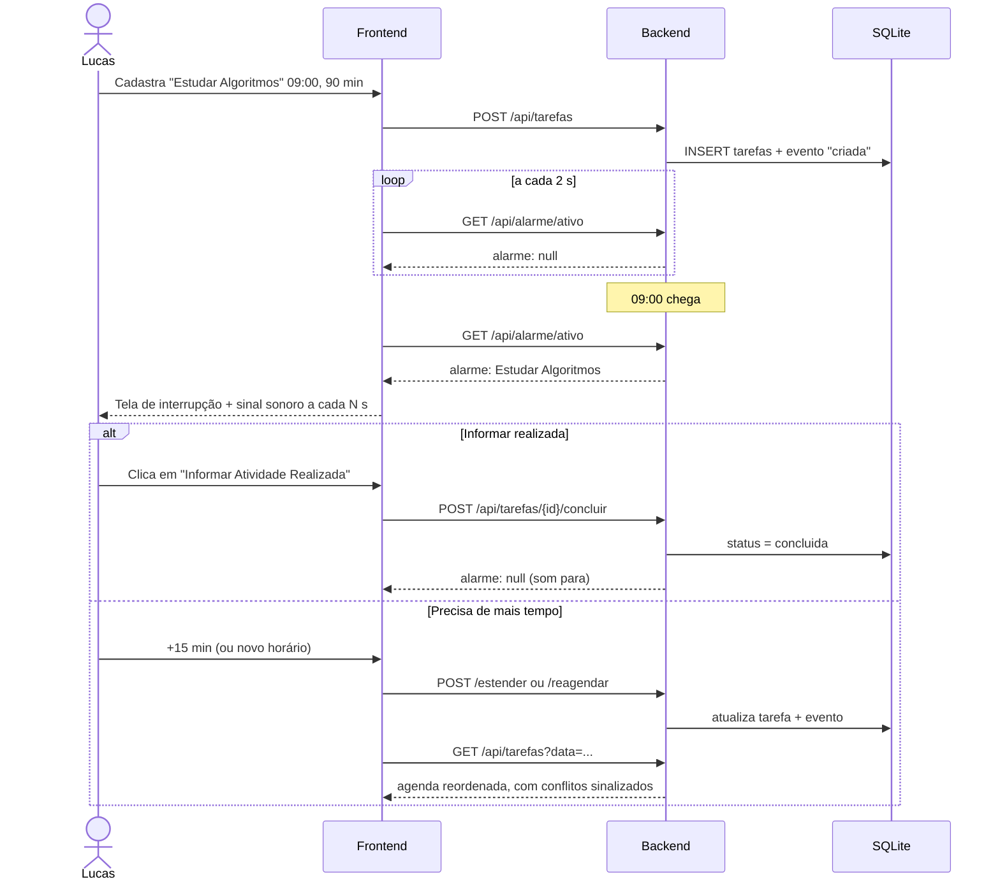
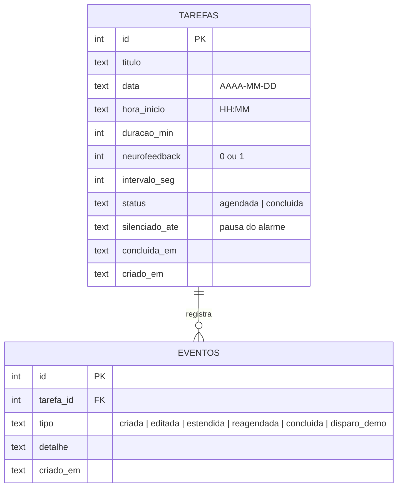

# Arquitetura e modelagem de dados

## Visão geral



- **Um único processo** serve o frontend estático e a API. Subir tudo é `python backend/app.py`.
- **A regra do alarme fica no servidor**, não no navegador. O frontend consulta `GET /api/alarme/ativo` a cada 2 s e apenas reage ao que o servidor informa.
- **Relógio injetável** (`create_app(clock=...)`): os testes simulam "09:00 do dia seguinte" sem esperar.

## Fluxo da jornada principal



## Regras de negócio

| Código | Regra |
|---|---|
| RN1 | O alarme está ativo quando a atividade está `agendada`, com neuro-feedback ligado, o horário de início já passou e não há pausa em vigor |
| RN2 | O alarme só deixa de estar ativo ao informar a atividade realizada, ao pausar por acréscimo de tempo ou ao reagendar para o futuro |
| RN3 | Acrescentar tempo soma minutos à duração e pausa o alarme pelo mesmo número de minutos |
| RN4 | Reagendar exige horário no futuro e remove qualquer pausa |
| RN5 | Duas atividades agendadas no mesmo dia que se sobrepõem são sinalizadas como conflito |
| RN6 | Concluir é idempotente: concluir de novo não duplica o evento |
| RN7 | Toda mudança relevante gera um registro em `eventos` (base para o histórico de neuro-feedback) |

## Modelagem de dados



### Dicionário de dados — `tarefas`

| Campo | Tipo | Descrição |
|---|---|---|
| `id` | INTEGER | Chave primária |
| `titulo` | TEXT (1–100) | Nome da atividade |
| `data` | TEXT | Dia da atividade, `AAAA-MM-DD` |
| `hora_inicio` | TEXT | Horário de início, `HH:MM` |
| `duracao_min` | INTEGER (5–1440) | Duração prevista em minutos |
| `neurofeedback` | INTEGER | 1 liga o alarme persistente |
| `intervalo_seg` | INTEGER | Intervalo entre os sinais sonoros (5–600 s) |
| `status` | TEXT | `agendada` ou `concluida` |
| `silenciado_ate` | TEXT | Até quando o alarme está pausado por acréscimo de tempo |
| `concluida_em` | TEXT | Momento em que foi informada como realizada |
| `criado_em` | TEXT | Momento do cadastro |

### Dicionário de dados — `eventos`

| Campo | Tipo | Descrição |
|---|---|---|
| `id` | INTEGER | Chave primária |
| `tarefa_id` | INTEGER | Atividade relacionada (exclusão em cascata) |
| `tipo` | TEXT | Tipo do evento |
| `detalhe` | TEXT | Informação adicional, por exemplo `+15 min (total 105 min)` |
| `criado_em` | TEXT | Momento do evento |

## Contrato da API

Todas as respostas são JSON. Erros devolvem `{"erro": "mensagem"}` com status 400, 404 ou 409.

**Objeto de atividade**

```json
{
  "id": 1,
  "titulo": "Estudar Algoritmos",
  "data": "2026-11-21",
  "hora_inicio": "09:00",
  "hora_fim": "10:30",
  "duracao_min": 90,
  "neurofeedback": true,
  "intervalo_seg": 30,
  "status": "agendada",
  "concluida_em": null,
  "alarme_ativo": false,
  "decorrido_seg": 0,
  "excedido_seg": 0,
  "conflito": false
}
```

| Rota | Corpo | Respostas |
|---|---|---|
| `GET /api/saude` | — | 200 |
| `GET /api/tarefas?data=` | — | 200 `{data, tarefas[]}` · 400 data inválida |
| `POST /api/tarefas` | `titulo`, `data`, `hora_inicio`, `duracao_min?`, `intervalo_seg?`, `neurofeedback?` | 201 · 400 |
| `GET /api/tarefas/<id>` | — | 200 · 404 |
| `PATCH /api/tarefas/<id>` | `titulo?`, `duracao_min?`, `intervalo_seg?`, `neurofeedback?` | 200 · 400 · 404 |
| `DELETE /api/tarefas/<id>` | — | 200 · 404 |
| `GET /api/alarme/ativo` | — | 200 `{alarme, total_ativos, agora}` |
| `POST /api/tarefas/<id>/concluir` | — | 200 · 404 |
| `POST /api/tarefas/<id>/estender` | `minutos` (5–240) | 200 · 400 · 409 se já concluída |
| `POST /api/tarefas/<id>/reagendar` | `hora_inicio`, `data?` | 200 · 400 (passado) · 409 |
| `POST /api/tarefas/<id>/disparar-agora` | — | 200 · 409 (atalho de demonstração) |
| `GET /api/tarefas/<id>/eventos` | — | 200 `{eventos[]}` |

## Decisões técnicas

- **Flask + SQLite:** o enunciado pede front, back e modelagem de dados; essa dupla entrega os três com a menor configuração possível, e o professor consegue rodar com três comandos.
- **JavaScript puro:** sem `npm`, sem build. Um erro de instalação a menos no dia da avaliação.
- **Consultas parametrizadas** (`?`) em todo o SQL e **escape de HTML** nos títulos exibidos, evitando injeção de SQL e XSS.
- **Sem autenticação** na PoC: assumido como fora do escopo (ver README).
