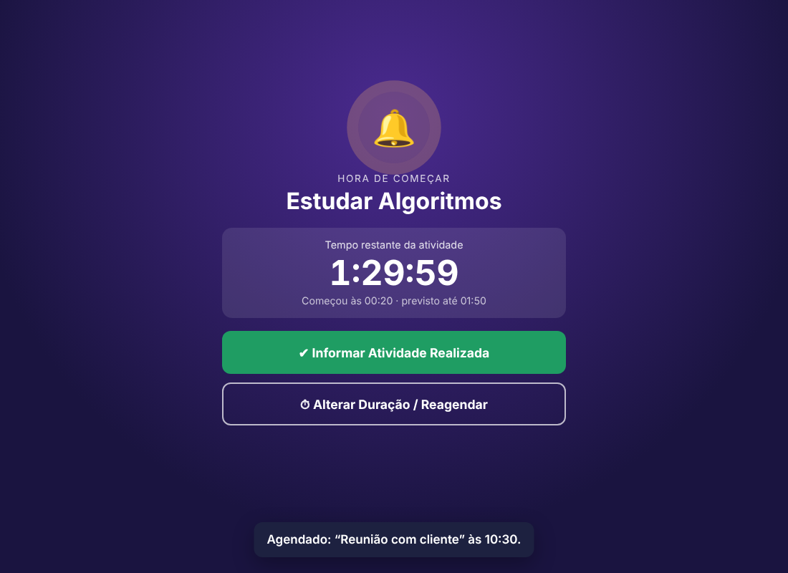
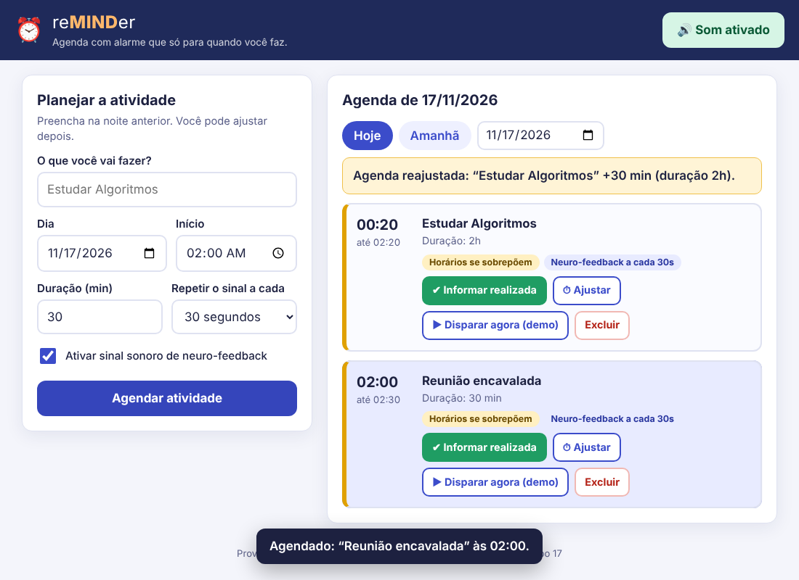
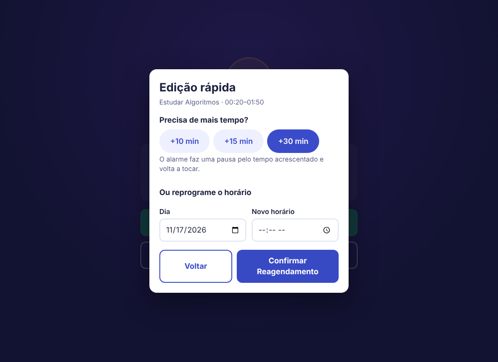
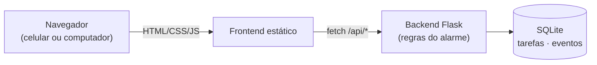

# ReMINDer — Prova de Conceito (PoC)

Agenda de atividades diárias com **alarme sonoro persistente**: o sinal toca em intervalos regulares e **só para quando a pessoa informa que a atividade foi realizada**. Pensada para pessoas com TDAH/TDA, que costumam dispensar alarmes comuns no "soneca" e esquecer o que precisavam fazer.

Projeto Integrador — Desenvolvimento de Sistemas Orientado a Dispositivos Móveis e Baseados na Web (Senac EAD, TADS/TSI) · **2ª etapa: Prova de Conceito**.

## Integrantes (Grupo 17)

- Diego Cunha de Miranda
- Paulo Heitor Ibsen Troyano
- Jhonathan Pablo Santos Silva

## O que esta PoC prova

Na 1ª etapa o grupo definiu o produto, as personas e as jornadas. Esta etapa implementa **uma única jornada**, a do Lucas (estudante, 21 anos), mais o reajuste de agenda da Camila (designer freelancer, 31 anos):

> Planejar a atividade na véspera → o alarme toca no horário e persiste → informar "atividade realizada" **ou** pedir mais tempo / reagendar → ver a agenda reordenada.

A hipótese a validar é: *um alarme que só para com a confirmação do usuário funciona como mecanismo de "neuro-feedback" numa agenda web simples, sem depender de apps nativos.* A justificativa da escolha e a revisita do projeto estão em [`docs/DEFINICAO_POC.md`](docs/DEFINICAO_POC.md).

### Correspondência com as telas da 1ª etapa

| Tela da 1ª etapa | Onde está na PoC |
|---|---|
| Planejamento / cadastro da atividade | Formulário "Planejar a atividade" |
| Tela de Sinal Sonoro Ativo (Modo Interrupção) | Tela cheia com nome da tarefa, cronômetro (tempo restante / duração excedida) e botões **Informar Atividade Realizada** e **Alterar Duração / Reagendar** |
| Modal de Edição Rápida de Tarefa | Seletor **+10 / +15 / +30 min**, campo de novo horário e **Confirmar Reagendamento** |
| Tela de Agenda Diária Reordenada | "Agenda do dia" reordenada por horário, com aviso do ajuste e sinalização de horários que se sobrepõem |

### Telas

| Modo interrupção | Agenda reajustada | Edição rápida |
|---|---|---|
|  |  |  |

## Stack

| Camada | Tecnologia | Por quê |
|---|---|---|
| Frontend | HTML + CSS + JavaScript puro | Sem build e sem dependências; abre em qualquer celular ou computador |
| Backend | Python 3 + Flask | API REST pequena e fácil de explicar |
| Banco de dados | SQLite | Arquivo local, zero configuração |
| Testes | pytest (API) | Valida as regras do alarme com um relógio simulado |

## Arquitetura



O servidor decide **quando o alarme está ativo**; o navegador só consulta `/api/alarme/ativo` a cada 2 segundos e toca o som. Por isso o alarme continua tocando mesmo depois de recarregar a página. Detalhes e modelagem de dados em [`docs/ARQUITETURA_E_DADOS.md`](docs/ARQUITETURA_E_DADOS.md).

## Como executar

**Requisitos:** Python 3.9 ou superior e Git.

```bash
# 1. Clonar o repositório
git clone <URL-DO-REPOSITORIO>
cd reminder-poc

# 2. Criar e ativar um ambiente virtual
python -m venv .venv
source .venv/bin/activate        # macOS / Linux
# .venv\Scripts\activate         # Windows (PowerShell ou CMD)

# 3. Instalar as dependências
pip install -r requirements.txt

# 4. Subir o servidor (cria o banco automaticamente)
python backend/app.py
```

Abra **http://localhost:8000** no navegador.

- Outra porta: `PORT=9000 python backend/app.py` (Windows PowerShell: `$env:PORT=9000; python backend/app.py`).
- Zerar os dados: pare o servidor e apague `backend/reminder.db`.
- Usar outro arquivo de banco: variável de ambiente `REMINDER_DB`.

### Rodar os testes

```bash
python -m pytest backend/tests -q
```

Os 16 testes cobrem: validações, alarme no horário e persistente, parada só ao concluir, pausa por acréscimo de tempo, reagendamento, detecção de conflito e histórico de eventos.

### Como demonstrar a jornada (2 minutos)

1. Clique em **🔇 Ativar som** (navegadores só liberam áudio após um clique).
2. Em **Planejar a atividade**, cadastre "Estudar Algoritmos", 09:00, 90 min, neuro-feedback ligado → **Agendar atividade**.
3. Na agenda, clique em **▶ Disparar agora (demo)** para simular que chegou o horário (atalho só de demonstração, para não esperar o relógio).
4. A tela de interrupção abre e o sinal repete a cada 30 s. **Recarregue a página**: o alarme continua.
5. Clique em **Alterar Duração / Reagendar**, escolha **+15 min** e confirme: o alarme pausa pelo tempo acrescentado e a agenda mostra o ajuste.
6. Quando o alarme voltar, clique em **Informar Atividade Realizada**: o som para na hora e a atividade fica concluída.

## API (resumo)

| Método | Rota | Função |
|---|---|---|
| GET | `/api/tarefas?data=AAAA-MM-DD` | Agenda do dia, ordenada por horário |
| POST | `/api/tarefas` | Cadastra atividade |
| PATCH / DELETE | `/api/tarefas/<id>` | Edita / exclui |
| GET | `/api/alarme/ativo` | Atividade com alarme tocando agora |
| POST | `/api/tarefas/<id>/concluir` | Informa atividade realizada (para o alarme) |
| POST | `/api/tarefas/<id>/estender` | Acrescenta minutos (`{"minutos": 15}`) |
| POST | `/api/tarefas/<id>/reagendar` | Novo horário (`{"data": "...", "hora_inicio": "14:00"}`) |
| POST | `/api/tarefas/<id>/disparar-agora` | Atalho de demonstração |
| GET | `/api/tarefas/<id>/eventos` | Histórico da atividade |

## Estrutura do repositório

```
reminder-poc/
├── backend/
│   ├── app.py              # API Flask + regras do alarme
│   ├── schema.sql          # Modelo de dados (SQLite)
│   └── tests/test_api.py   # Testes automatizados
├── frontend/
│   ├── index.html          # Telas
│   ├── style.css
│   └── app.js              # Lógica, alarme sonoro e chamadas à API
├── docs/                   # Definição da PoC, arquitetura, roteiro do vídeo, checklist
├── requirements.txt
└── README.md
```

## Limitações conhecidas (e próximos passos)

Esta é uma PoC, então ficou de fora de propósito:

- **Aba aberta:** o som toca enquanto a página está aberta. Um produto final precisa de notificações nativas/push (Android, iOS) para tocar com o app fechado.
- **Um único usuário:** sem login nem sincronização entre contas.
- **Edição completa pela interface:** a API já aceita `PATCH`, mas a tela só oferece ajuste de tempo e horário.
- **Apps nativos:** previstos na 1ª etapa; a PoC valida primeiro o mecanismo central na web.
- **Validação com usuários reais:** a PoC mostra viabilidade técnica, não eficácia clínica.
